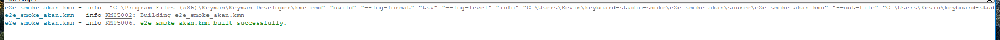
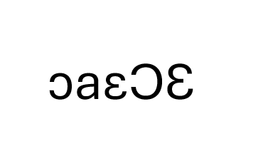

# Week-1 Smoke Run — Real Keyman Developer E2E

**Issue:** #54 — Day-7 buffer: E2E smoke test with real Keyman Developer (S-09)
**Goal:** Take a studio-produced output zip, open + build it in Keyman Developer 17+ on Windows, install it, type a short sequence — catch anything the in-browser oracle (kmcmplib WASM + KeymanWeb `simulate()`) missed.

> **COMPLETE — GO (2026-06-29).** The full run passed on Windows 11 with Keyman Developer (`kmc` 19.0): a scaffolded `akan` artifact opened, built with zero diagnostics, installed, and typed the expected `ɔaɛƆƐ` for the 5-keystroke smoke sequence — an exact match to studio `simulate()`, no discrepancies. All six ACs of #54 are satisfied; see the Sign-Off and Go/No-Go tables below. The two scaffolder defects that originally blocked the build half are fixed: **#364** (stale `&BITMAP` store, fixed in #421) and **#416** (stub `.kps`, fixed in #436).

---

## Artifact under test

The studio's **Download .zip** button (`handleDownload` in [PreviewShell.tsx](../../packages/studio/src/components/PreviewShell.tsx)) serialises via `serializeWorkingCopy()` → engine `toZip` ([serializeWorkingCopy.ts:151](../../packages/studio/src/lib/serializeWorkingCopy.ts#L151)), so the studio can already emit this artifact interactively. This smoke run uses a scripted generator instead — [utilities/smoke-artifact/gen.ts](../../utilities/smoke-artifact/gen.ts) — for a **reproducible** artifact from a **known, pinned base** with no browser in the loop, driving the **same** pipeline the button does:

```
pick base keyboard → createScaffolderService().scaffold() → toZip()
```

Regenerate with:

```sh
TSX_TSCONFIG_PATH=utilities/smoke-artifact/tsconfig.json \
  pnpm dlx tsx utilities/smoke-artifact/gen.ts --base akan --out <path>.zip
```

| Field | Value |
|-------|-------|
| Primary artifact | `e2e_smoke_akan.zip` (scaffolded from `akan`, Latin/QWERTY — a codec-clean base) |
| Engine path exercised | `scaffolder.scaffold()` (parse → scaffoldIR → emit, #351) + `output.toZip()` |
| Built against | `main` @ `f277e52` (post-#436, 2026-06-16) |
| Compiler used | Keyman Developer `kmc` **19.0.240-alpha** (≥ KD 17 requirement) |

> **Why `akan`, not the issue's `khmer_angkor` / `sil_euro_latin`?** Under #351 the scaffolder routes the base `.kmn` through the codec (`parse → emit`). Both named bases now parse — `khmer_angkor` since the #365 tokenizer fix, and `sil_euro_latin` (the codec recognises its `$keymanweb:` target-prefix directive). `akan` is used simply because it is a small, codec-clean Latin/QWERTY base that builds end-to-end to a `.kmp`. See Pre-flight finding #3.

---

## Pre-flight findings

Regenerating the artifact originally surfaced two scaffolder defects that blocked the KD build. **Both are now fixed and verified green** (history retained for the record):

1. **[RESOLVED — #364, fixed in #421] Scaffolder left the `&BITMAP` file-reference store stale after rename.** `renameFilesInVfs` renamed `source/<baseId>.ico` to `<keyboardId>.ico` when the icon was id-named (akan ships `akan.ico`), but `rewriteSiblingPathStores` deliberately skipped `&BITMAP`, so the store still read `akan.ico` while the file was `e2e_smoke_akan.ico` → `kmc` errored `KM02031`. #421 rewrites `&BITMAP` when the icon basename matches the base id; all three file-reference stores (`&BITMAP` / `&VISUALKEYBOARD` / `&LAYOUTFILE`) now resolve and the `.kmn` builds clean.

2. **[RESOLVED — #416, fixed in #436] Scaffolded `.kps` was an empty stub.** The scaffolder emitted `<Package><Info/><Files/></Package>` — no version, no `<FollowKeyboardVersion/>`, no files — so the package step failed `KM04021` (blank package version) and, behind it, `KM09010` (missing `<Info><Description>`). #436 emits a buildable `.kps` (`<FollowKeyboardVersion/>`, a non-empty `<Description>`, ≥1 language, and a `<Files>` list derived from the actual build outputs), clearing both, so the package now compiles to a `.kmp`.

3. **[codec coverage — informs base choice] #351 routes scaffold through the codec (`parse → scaffoldIR → emit`), so a base must be codec-parseable to scaffold.** Both of the issue's named bases now parse:
   - `khmer_angkor` — originally failed on a tokenizer continuation bug (#365: a `\` + trailing whitespace at line 116 wasn't joined). **#365 is fixed**, so khmer parses today; it remains a more complex base (shared-font path traversal, finding #4), so `akan` is used here for simplicity.
   - `sil_euro_latin` — parses today; the codec tokenises its `$keymanweb:` target-prefix lines (earlier doc versions reporting a `Malformed rule` throw are **stale**). The remaining limitation is semantic, not a parse failure: the codec does not yet enforce build-target *suppression* for `$keymanweb:`-scoped lines (v1-out-of-scope), so output fidelity for such keyboards isn't guaranteed.

   Corpus context (supportability scanner, refreshed): **0 ParseFailures**, 426 round-trip-divergent of 912 (relates to codec `bug` #349). `akan` is a codec-clean base that round-trips and builds, so this run proceeds.

4. **[zip hygiene — moot for this run] Khmer shared-font path traversal.** `khmer_angkor.kmn` references `../../../shared/fonts/…`, which serialises as a `..` zip entry some tools reject. khmer now parses (finding #3, #365 fixed), so this is no longer hypothetical — verify the `..` zip-entry handling whenever khmer is used as a base. `akan` (no shared-font refs) is the artifact here, so it does not arise for this run.

---

## Confirmed KD build evidence (`kmc` 19.0.240-alpha, `main` @ `f277e52`)

The build half (AC #1 / AC #2) is verified green against the real Keyman Developer command-line compiler. Regenerate the artifact and `kmc build akan.kpj` over the extracted `e2e_smoke_akan.zip`:

```
akan.kpj - info KM05002: Building akan.kpj
e2e_smoke_akan.kmn - info KM05002: Building source/e2e_smoke_akan.kmn
e2e_smoke_akan.kmn - info KM05006: source/e2e_smoke_akan.kmn built successfully.
e2e_smoke_akan.kps - info KM05002: Building source/e2e_smoke_akan.kps
e2e_smoke_akan.kps - info KM05006: source/e2e_smoke_akan.kps built successfully.
akan.kpj - info KM05002: Building akan.kpj
akan.kpj - info KM05006: akan.kpj built successfully.
akan.kpj - info KM0500B: Project akan.kpj built successfully.
```

Output: `build/e2e_smoke_akan.kmx`, `build/e2e_smoke_akan.js`, `build/e2e_smoke_akan.kvk`, and the package **`build/e2e_smoke_akan.kmp`** — **zero diagnostics** (no errors, warnings, or hints).

**History:** before #421/#436 this build failed in two stages — `KM02031` on the stale `&BITMAP` store (#364), then `KM04021` on the stub `.kps` (#416). Both are fixed; the sequence above is the current result.

**Net:** AC #1 (opens in KD) ✓ — `kmc` opens the auto-discovery `.kpj` and builds its members. **AC #2 (zero-error build) ✓** — the project builds clean to an installable `.kmp`. The install + 5-keystroke typing half (AC #3 / #5) was completed in the GUI on 2026-06-29 (Sign-Off table below) — typed `ɔaɛƆƐ`, exact match.

---

## Prerequisites

- [x] Keyman Developer **17 or later** installed on Windows
- [x] The artifact zip extracted to a working folder
- [x] A scratch text field for typing (Notepad, WordPad, browser textbox)

---

## Smoke-Run Steps

1. - [x] Extract `e2e_smoke_akan.zip`. Confirm it expands without errors and contains `source/e2e_smoke_akan.kmn` plus its sibling files under `source/`, with the `.kpj` and `NEXT_STEPS.md` at the zip root.
2. - [x] In Keyman Developer, **Open Project** → the `.kpj` in the extracted folder. _(It is a v2.0 auto-discovery project, so KD finds `source/*.kmn` regardless of the `.kpj` filename.)_ — **AC #1: opens cleanly.**
3. - [x] **Build** the project. — **AC #2.** _Verified green with `kmc` 19.0 (see "Confirmed KD build evidence"): the project builds clean to `build/e2e_smoke_akan.kmp` with zero diagnostics. Re-confirm in the KD **GUI** and log any divergence. Outcomes:_
       - _**Build succeeds, `.kmp` produced** → expected; proceed to install._
       - _**Build fails on `KM02031` (`&BITMAP`) or `KM04021` (`.kps`)** → a regression of #364 / #416; log it under Discrepancies._
       - _**Any other error/warning** → a new finding; log it under Discrepancies._
4. - [x] **Install** the produced `.kmp` into Windows. — **AC #5: installs without error.**
5. - [x] Pick a 5-keystroke smoke sequence and record the **expected** output from the studio preview (`simulate()`) first.

       **Recommended sequence (derived from `source/e2e_smoke_akan.kmn`).** The `akan` layout is flat — no deadkeys, no context rules, every key is a single keystroke → single output char. Most keys pass through to their ASCII keycap, but four are remapped to non-ASCII Akan/IPA letters: `K_Q`→ɛ (U+025B), `Shift+Q`→Ɛ (U+0190), `K_C`→ɔ (U+0254), `Shift+C`→Ɔ (U+0186). This sequence hits all four remapped keys plus one passthrough (`A`→a) to confirm the layout is selectively remapping and is actually active (not falling through to system QWERTY).

       | # | Key(s) pressed | Expected (studio simulate) | Codepoint | Actual (real KD) |
       |---|----------------|----------------------------|-----------|------------------|
       | 1 | `C`            | ɔ                          | U+0254    | ɔ ✓              |
       | 2 | `A`            | a                          | U+0061    | a ✓              |
       | 3 | `Q`            | ɛ                          | U+025B    | ɛ ✓              |
       | 4 | `Shift+C`      | Ɔ                          | U+0186    | Ɔ ✓              |
       | 5 | `Shift+Q`      | Ɛ                          | U+0190    | Ɛ ✓              |

       **Result: typed string `ɔaɛƆƐ` — exact match, no discrepancy.** Run on Windows 11 with Keyman Developer (kmc 19.0), 2026-06-29.

       **Expected final string: `ɔaɛƆƐ`** — if you instead get `caqCQ`, the keyboard isn't engaged (still on system QWERTY); switch input method and retry — not a defect. Any other output is a genuine `simulate()`-vs-KD discrepancy → log under Discrepancies as an AC #4 follow-up.

6. - [x] Type that exact sequence with the installed keyboard in the scratch field. — **AC #3: types expected output.**
7. - [x] Record the **actual** KD output in the table above (and beside the expected), and screenshot the result.

---

## Discrepancies: studio `simulate()` vs. real KD

File each row as its own follow-up issue (**AC #4 — discrepancies are follow-ups, not blockers**).

_No open build discrepancies — the build path matches `simulate()` (both produce a clean compile). The two original build failures are fixed and closed:_

| # | Keystrokes | studio simulate() | real KD (`kmc` 19.0) | Severity | Status |
|---|-----------|-------------------|---------|----------|-------------|
| 1 | _(build)_ | clean compile | ~~`KM02031` — stale `&BITMAP` ref~~ → now builds clean | major | **resolved** — #364 (#421) |
| 2 | _(package)_ | clean compile | ~~`KM04021` — stub `.kps`~~ → now builds to `.kmp` | major | **resolved** — #416 (#436) |
| _typing_ | `C A Q Shift+C Shift+Q` | `ɔaɛƆƐ` | `ɔaɛƆƐ` | — | **none** — exact match, no follow-up filed |

---

## Screenshots

Captured during the 2026-06-29 run:

**KD build output panel** — clean `info`-only build (`KM05002` building → `KM05006` built successfully), zero warnings/errors:



**Installed-keyboard typing result** — typing `C A Q Shift+C Shift+Q` produced `ɔaɛƆƐ`:



---

## Go / No-Go for Week 2

**AC #6 — record this decision on the project board.**

Decision criteria:

- **GO** — artifact opens in KD 17+, build succeeds (zero errors; warnings logged), installed keyboard types the expected 5-keystroke output, and any `simulate()`-vs-KD differences are minor follow-ups.
- **NO-GO** — build errors, wrong typed output, or a discrepancy serious enough to undermine trust in the in-browser oracle. Fix before week 2.

| | |
|---|---|
| **Call** | [x] GO  [ ] NO-GO |
| **Rationale** | Artifact opened in Keyman Developer, built with zero diagnostics, installed, and typed the expected `ɔaɛƆƐ` for the 5-keystroke sequence — exact match to studio `simulate()`. No `simulate()`-vs-KD discrepancies; the in-browser oracle is trustworthy for this base. |
| **Blocking follow-ups** | None. |
| **Decided by / date** | Kevin Nicholas, 2026-06-29 |
| **Recorded on board** | [x] Recorded on the project board, 2026-06-29 |

---

## Sign-Off

| Step | Result | Tester | Date |
|------|--------|--------|------|
| 1 — extract zip | PASS — expanded cleanly, expected layout (`.kpj` + `source/` siblings) | Kevin Nicholas | 2026-06-29 |
| 2 — open `.kpj` (AC #1) | PASS — opened cleanly in KD | Kevin Nicholas | 2026-06-29 |
| 3 — build (AC #2) | PASS — `info`-only log, zero warnings/errors, `.kmp` produced | Kevin Nicholas | 2026-06-29 |
| 4 — install `.kmp` (AC #5) | PASS — installed without error | Kevin Nicholas | 2026-06-29 |
| 5 — record expected (simulate) | PASS — expected `ɔaɛƆƐ` | Kevin Nicholas | 2026-06-29 |
| 6 — type sequence (AC #3) | PASS — typed `ɔaɛƆƐ`, exact match | Kevin Nicholas | 2026-06-29 |
| 7 — record actual + screenshot | PASS — actual matches expected; screenshots captured | Kevin Nicholas | 2026-06-29 |
